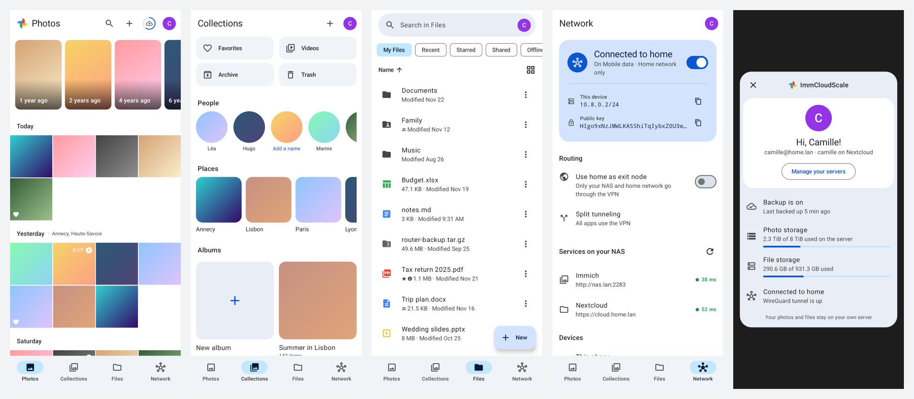
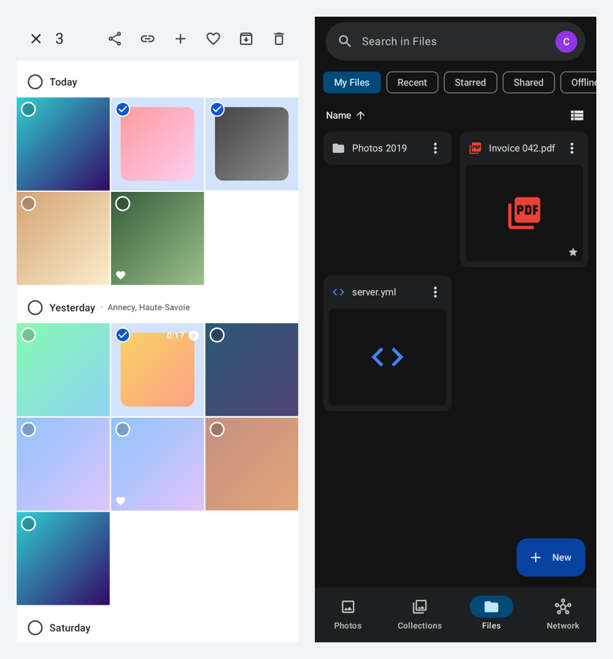

# ImmCloudScale: photos, files and home VPN for your NAS

[](https://github.com/FenOps/immcloudscale/actions/workflows/ci.yml)
[](LICENSE)

One Android app that does the work of three self-hosted apps, laid out like Google Photos and Google Drive:

| Tab | Backed by | Replaces |
|---|---|---|
| **Photos** + **Collections** | your [Immich](https://immich.app) server | Immich app |
| **Files** | your [Nextcloud](https://nextcloud.com) server (WebDAV + OCS) | Nextcloud Files app |
| **Network** | a WireGuard tunnel to your home (wireguard-go, the engine Tailscale is built on) | Tailscale / WireGuard app |





Each feature comes from the one product that does it best, so nothing is duplicated: photos and videos
live in Immich, everything else in Nextcloud, and the VPN makes both reachable away from home.

## Quick start: the server and the app

1. **On the NAS** (Ubuntu 22.04+/Debian 12), install the [ImmCloudScale Server](server/README.md). It sets up Immich,
   Nextcloud and WireGuard together and gives you a web console for people and phones:
   ```bash
   curl -fsSL https://raw.githubusercontent.com/FenOps/immcloudscale/main/server/deploy/install.sh | sudo bash
   ```
2. **On the phone**, install `ImmCloudScale-<version>.apk` from [Releases](https://github.com/FenOps/immcloudscale/releases/latest)
   and scan the pairing QR code. Photos, files and the home VPN are configured in one step.

**→ Step-by-step guide: [INSTALL.md](INSTALL.md)**, including prompts that let Claude Code do most of the installation for you.

Already running Immich and Nextcloud yourself? The app also connects to existing servers (see "Setting up your servers" below).

## Features

### Photos (Immich)
* Google Photos-style timeline: day headers with place names, square tiles, video durations, favourite hearts, infinite scroll, pull to refresh
* Pinch the grid to change the number of columns (2–7)
* **Memories** ("1 year ago…") carousel at the top
* Long-press to select, tap a date to select the whole day; then share, create a public link, add to an album (or a new one), favourite, archive or move to trash
* Full-screen viewer: swipe between photos, pinch and double-tap to zoom, streamed video playback (ExoPlayer), info sheet (camera, exposure, size, location, people)
* **Backup**: automatic upload of new photos/videos (WorkManager), Wi-Fi-only / charging-only / videos toggles, choice of device folders, "Back up now" with progress in the top bar. Files are de-duplicated with Immich's SHA-1 check, so re-installing never uploads twice.
* **Collections**: Favourites, Videos, Archive, Trash (restore, delete forever, empty), People, Places, Albums and Shared albums, New album
* **Search**: smart search (Immich's CLIP machine learning: "dog on the beach"), with People, Places and categories as starting points

### Files (Nextcloud)
* Google Drive-style browser: "Search in Files" pill, **My Files / Recent / Starred / Shared / Offline** chips, breadcrumbs, sort by name / date / size, list or grid view with thumbnails
* **New** button: create a folder, upload files from the phone
* Item sheet: copy share link, star, **available offline**, open with another app, send a copy, rename, move, make a copy, details, remove
* In-app preview of images (zoomable), video and audio (streamed), PDFs (rendered on the phone) and text/code
* Search by file name across the whole account; storage quota in the account card

### Network (home VPN)
* One switch to connect to home, with status, current network, this device's tunnel address and public key
* **Exit node**: route all traffic through home, or only the NAS and home LAN (split by route)
* **Split tunnelling** per app: chosen apps bypass the VPN
* **Auto-connect** when you leave trusted Wi-Fi networks, and disconnect when you're back; **Always-on VPN** support
* Device list with online status, last handshake and traffic counters
* Live health checks of your Immich and Nextcloud servers with latency
* Set up by importing a `.conf` file, pasting one, or **Add this device**: the phone generates its key pair and shows the public key to add on the NAS

### Across the app
* Google-style account card: who you are on each server, backup status, photo and file storage bars, VPN state
* "Share to ImmCloudScale" from any app: photos and videos go to Immich, other files to Nextcloud
* Material 3 with Google's palette, dynamic colour on Android 12+, light and dark themes, edge to edge

## Setting up your servers

With the ImmCloudScale Server, tap **Scan QR code** on the first screen (or scan the code with the camera) and you're done.
To connect servers you already run instead, the app asks for:

1. **Immich**: server URL (e.g. `http://192.168.1.10:2283`), then email + password, or an API key (Immich → Account settings → API keys).
2. **Nextcloud**: server URL, then **Sign in with browser** (Nextcloud Login Flow v2, gives the app its own app password), or a user name + app password.
3. **VPN** (optional): a WireGuard config for this phone. Most NAS systems can make one: Synology VPN Server, Unraid's VPN Manager, TrueNAS, OpenMediaVault, wg-easy in Docker, or a router (UniFi, OpenWrt, FRITZ!Box, OPNsense…).

If your servers are only reachable at home, set up the VPN first and use their LAN or tunnel addresses.
Plain HTTP and certificates from a CA installed on the phone are allowed, since home servers often use them.

### About "Tailscale"
The Network tab runs **WireGuard** through `wireguard-go`, the same userspace engine Tailscale uses, and adds
Tailscale-style controls on top: exit node, split tunnelling, auto-connect and a device list. It connects
to a WireGuard server you run: the ImmCloudScale Server sets one up and adds each paired phone automatically. It does not talk to Tailscale's or Headscale's coordination
servers, so there is no NAT traversal or automatic key exchange between devices: the NAS needs a reachable
WireGuard port (port forward, or a VPS relay).

## Build

Requirements: JDK 17+, Android SDK with platform 35.

```bash
./gradlew :app:assembleDebug          # app/build/outputs/apk/debug/app-debug.apk
./gradlew :app:testDebugUnitTest      # unit, client (MockWebServer), pairing, app smoke (Robolectric) and screenshot tests
# optional: pair against a live server too
ICS_E2E_SERVER=http://<nas>:8790 ICS_E2E_CODE=<code> ./gradlew :app:testDebugUnitTest --tests '*PairingTest*'
./gradlew :app:recordPaparazziDebug   # re-record screenshots after UI changes
```

Min SDK 26 (Android 8.0), target SDK 35. GitHub Actions builds the APK and runs all tests on every push and pull request
(artifact: `immcloudscale-debug-apk`). To publish a release with the APK and the server packages, open **Actions → CI → Run workflow** and enter a version (e.g. `0.2.0`), or push a tag `v<version>`.

### Stable signing for published APKs (maintainers)

Android only installs an update over an existing app when both are signed with the same key. Without a key, CI signs each
build with a temporary key, so people would have to uninstall before updating. To publish updatable APKs, create a key once:

```bash
keytool -genkeypair -keystore immcloudscale.jks -alias immcloudscale -keyalg RSA -keysize 4096 -validity 36500
base64 -w0 immcloudscale.jks > immcloudscale.jks.b64     # macOS: base64 -i immcloudscale.jks -o immcloudscale.jks.b64
```

Then in GitHub → **Settings → Secrets and variables → Actions**, add `ICS_KEYSTORE_B64` (the contents of the `.b64` file),
`ICS_KEYSTORE_PASSWORD` and `ICS_KEY_ALIAS` (`immcloudscale`). Keep the `.jks` file and password safe and private: if you lose
them, existing installs can't be updated, and anyone who has them can publish updates.

### Signed release
Create `keystore.properties` next to this README (git-ignored):

```properties
storeFile=/absolute/path/to/release.jks
storePassword=...
keyAlias=...
keyPassword=...
```

then `./gradlew :app:assembleRelease` or `:app:bundleRelease`.

## Code map

`server/` is the Go home server (see its README). The Android app:

```
app/src/main/java/app/immcloudscale/
  ImmApp.kt              app graph (settings, one OkHttp client, Immich, Nextcloud, VPN), Coil setup, share uploads
  data/
    Settings.kt          DataStore-backed settings
    Http.kt              auth interceptor: picks Immich token or Nextcloud basic auth by URL
    immich/              Immich REST client, models, day grouping
    nextcloud/           WebDAV/OCS client, multistatus parser, Login Flow v2
    vpn/                 GoBackend tunnel manager, routing rules, auto-connect, config helpers
    backup/              MediaStore scan + Immich backup worker
    pairing/             pairing with an ImmCloudScale server (QR / deep link / code)
  ui/
    App.kt               navigation, bottom bar, account dialog, share-to dialog
    photos/ collections/ files/ network/ account/ components/ theme/
```

## Privacy
Credentials (Immich token, Nextcloud app password, WireGuard private key) are stored in the app's private storage
and excluded from Android backups. The app only talks to the servers you configure.

## License

ImmCloudScale is free software under the [GNU Affero General Public License v3.0](LICENSE) (AGPL-3.0-only), the same
license as Immich and Nextcloud. If you run a modified version for other people over a network, you must offer them its source.

ImmCloudScale is an independent project, not affiliated with Immich, Nextcloud, WireGuard, Tailscale or Google.
It installs Immich and Nextcloud from their official container images; they keep their own licenses.
