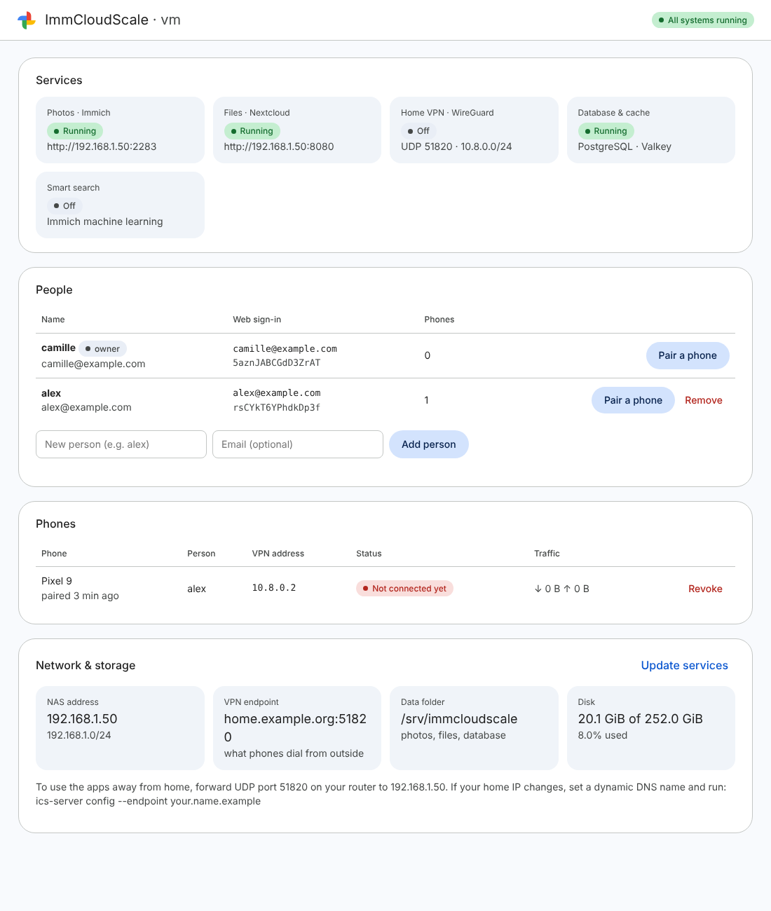
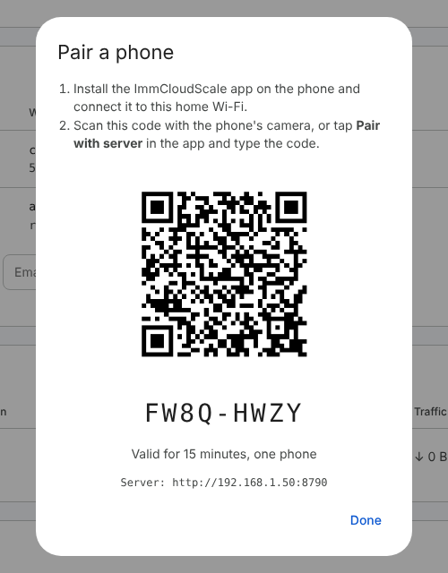

# ImmCloudScale Server

The home-server half of ImmCloudScale. Install it once on your Ubuntu or Debian NAS and it sets up,
connects and looks after everything the Android app uses:

* **Photos**: Immich (server, machine learning, PostgreSQL, Valkey)
* **Files**: Nextcloud (+ background jobs), sharing the same database server
* **Home VPN**: WireGuard on the host, with one peer per paired phone

You manage people and phones from one place, `ics-server` or its web console, and a phone is set up
by scanning a QR code: no server URLs, passwords, API keys or WireGuard configs to copy.



## Install

On Ubuntu 22.04/24.04/26.04 or Debian 12 (amd64 or arm64):

```bash
curl -fsSL https://raw.githubusercontent.com/FenOps/immcloudscale/main/server/deploy/install.sh | sudo bash
```

The installer adds Docker, Docker Compose and WireGuard from your distribution, installs `ics-server` (from the newest
release, or built from source before the first release), then runs `ics-server setup`. When it's done, setup prints:
* the admin console address and password,
* your web sign-in for Immich and Nextcloud,
* a QR code to pair your phone.

The first start downloads about 5 GB of container images.

Options go after `bash -s --`, for example `| sudo bash -s -- --user alex --data-dir /mnt/tank/immcloudscale --no-ml`:
`--data-dir` (where photos and files go), `--no-ml` / `--ml` (smart search and faces; off automatically below 6 GB RAM),
`--endpoint myhome.duckdns.org` (VPN address for phones away from home), `--allow-sleep` (setup otherwise turns off
suspend, because a sleeping server can't serve phones).

Setup checks Docker, Compose and WireGuard, the RAM and free disk space, picks free ports, turns on IP forwarding for
the VPN, downloads the images with progress (no timeout on slow connections), starts everything, and only shows the
pairing QR code once the pairing service answers.

Other ways: `sudo apt install ./immcloudscale-server_<version>_<arch>.deb && sudo ics-server setup` with a package from
[Releases](https://github.com/FenOps/immcloudscale/releases), or `sudo ./server/deploy/install.sh` from a clone.

**[INSTALL.md](../INSTALL.md)** has the full walkthrough for server and phone, including prompts that let Claude Code do it for you.

## Pair a phone



1. Install the ImmCloudScale APK and connect the phone to your home Wi-Fi.
2. Show a code: **Pair a phone** in the admin console (`http://<nas>:8790`), or `sudo ics-server pair <person>`.
3. Scan the QR code with the phone's camera, or open the app → **Scan QR code** / type the server address and code.

The phone makes its own WireGuard key and sends only the public half. The server answers with:
* an Immich API key for that phone,
* a Nextcloud app password for that phone,
* the VPN settings.

Codes work once and expire after 15 minutes, and guessing is rate limited. **Revoke** a lost phone in the
console: its VPN peer, API key and app password are deleted together.

<br clear="right">

## Use it away from home

Forward **UDP 51820** on your router to the NAS. Setup uses your current public IP as the VPN address.
If your ISP changes it, set up a dynamic DNS name (DuckDNS, No-IP, your router's own…) and run:

```bash
sudo ics-server config --endpoint myhome.duckdns.org
```

Then pair phones again, or edit the endpoint in each phone's Network tab.

The phones use the NAS's LAN address for photos and files. At home that works directly; away from home
the VPN routes it, so nothing changes in the app. The VPN can also act as an exit node, which sends all of a phone's traffic through home.

## Everyday commands

| | |
|---|---|
| `ics-server status` | services, disk, people, phones |
| `ics-server user add sam --email sam@example.com` | new person: Immich + Nextcloud accounts with one password |
| `ics-server user list` | people and their web sign-in passwords |
| `ics-server pair sam` | pairing QR in the terminal |
| `ics-server devices` / `revoke <id>` | list / disconnect phones |
| `ics-server update` | pull newer images of the pinned versions and restart |
| `ics-server admin-password` | the web console password |

The web console does the same things: add or remove people, pair phones, revoke phones, update.

## What gets installed where

| Path | What |
|---|---|
| `/srv/immcloudscale/photos` | Immich library (originals, thumbnails, encoded video) |
| `/srv/immcloudscale/files` | Nextcloud data |
| `/srv/immcloudscale/database` | PostgreSQL (Immich and Nextcloud databases) |
| `/opt/immcloudscale/` | generated `docker-compose.yml` and `.env` |
| `/etc/wireguard/ics0.conf` | VPN interface (10.8.0.1/24), managed by `ics-server` |
| `/var/lib/immcloudscale/state.json` | settings, people, phones and generated secrets (root only, 0600) |

Ports on the LAN: Immich `2283`, Nextcloud `8080`, console and pairing `8790`, VPN `51820/udp`. If one is already used by
another program on first setup, the next free port is chosen and printed (phones learn it when they pair).
If `ufw` is active, setup allows them from your LAN and the VPN only.

**Back up** `/srv/immcloudscale` and `/var/lib/immcloudscale/state.json`. Use `pg_dump` for consistent database copies, or stop the stack first.

## Security notes

* The console uses HTTP Basic auth and, like Immich and Nextcloud here, plain HTTP on your LAN. Keep those ports off the internet;
  reach them away from home through the VPN. Only UDP 51820 should be forwarded.
* `state.json` holds the generated service passwords so the server can provision accounts and per-phone keys.
* Each phone gets its own revocable credentials; nothing is shared between phones.

## Uninstall

```bash
sudo apt remove immcloudscale-server
sudo systemctl disable --now wg-quick@ics0
cd /opt/immcloudscale && sudo docker compose down        # add -v to delete the Nextcloud app volume
# your photos and files stay in /srv/immcloudscale until you delete them
```

## Development

```bash
go test ./...                 # unit tests (fake Immich / Nextcloud / Docker / WireGuard)
go build ./cmd/ics-server
./deploy/build-deb.sh         # dist/immcloudscale-server_<version>_{amd64,arm64}.deb
```

A release (Actions → CI → **Run workflow** with a version, or a pushed `v<version>` tag) publishes the APK and `.deb` files, which `install.sh` downloads.

Layout: `cmd/ics-server` (CLI), `internal/core` (setup, people, pairing, revoke),
`internal/stack` (compose bundle), `internal/wg` (keys, config, peers), `internal/immich` and
`internal/nextcloud` (provisioning APIs), `internal/web` (pairing API + console), `internal/state`
(locked JSON store shared by the CLI and the service).
